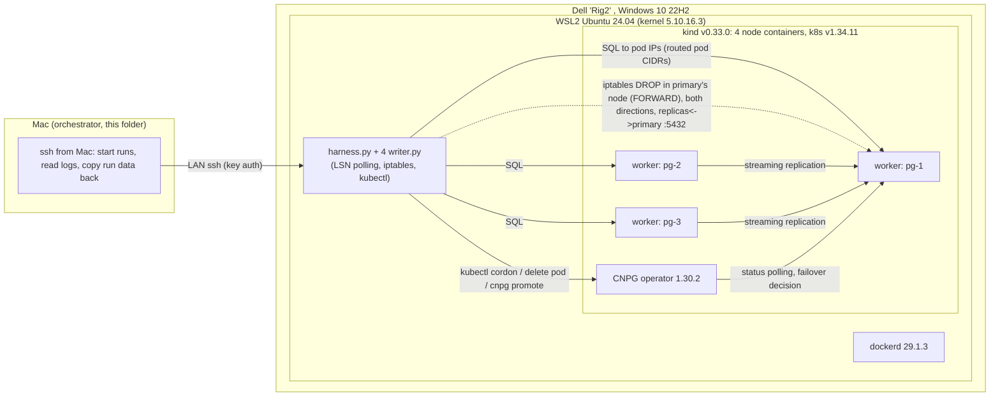

# cnpg-SETUP: CloudNativePG on Rig 2 (Dell), 2026-11-22

Supersedes the blocked first attempt (SSH key not authorised). Step 0 is **done**. Every version below was read from the running system, not recalled.

## What talks to what

Walkthrough: the Mac only starts things over SSH and copies results back. The harness runs inside WSL on the Dell, writes to the primary pod over the kind bridge, reads LSNs from every pod directly, cuts replication with iptables on the primary's kind node, then kills the primary (cordon its node, force-delete its pod) and triggers the promotion path. The operator, kubelet and PostgreSQL all run in the same Windows host. The "LAN" in this study is only the Mac-to-Dell SSH hop; replication traffic never leaves the machine.

## Versions (read from the system)

| Item | Version | How read |
|---|---|---|
| Dell OS | Windows 10 Home 10.0.19045 (22H2), i7-8700, 32 GB, Toshiba DT01ACA200 2 TB **HDD** | systeminfo, Get-PhysicalDisk |
| WSL | inbox WSL2, kernel 5.10.16.3-microsoft-standard-WSL2 | `wsl --status`, `uname -r` |
| Distro | Ubuntu 24.04.5 LTS (rootfs from releases.ubuntu.com, SHA-256 checked against their SHA256SUMS) | `/etc/os-release` |
| Docker Engine | 29.1.3 (Ubuntu docker.io), cgroup v1 | `docker --version`, `docker info` |
| kind / node image | v0.33.0 / kindest/node v1.34.11 (containerd 2.3.4, Debian 13) | `kind version`, `kubectl get nodes` |
| kubectl / helm | v1.37.2 / v3.22.1 | `--version` |
| CNPG operator | **1.30.2** (image ghcr.io/cloudnative-pg/cloudnative-pg:1.30.2; Helm chart cnpg/cloudnative-pg 0.29.2) | Deployment image, `helm search` |
| kubectl cnpg plugin | 1.30.2 (Commit 30cca36d3, 2026-11-17) | `kubectl cnpg version` |
| PostgreSQL | **17.11** (Debian 17.11-1.pgdg11+2), image `ghcr.io/cloudnative-pg/postgresql:17` | `select version()` |

## Cluster as run

3 instances (pg-1..3), asynchronous streaming, replication slots on (CNPG default), required pod anti-affinity so each instance sits on its own kind worker, `enableSuperuserAccess: true` (harness connects as `postgres`), resources: request 250m CPU / 512Mi, no limit. Everything else is the operator default (`failoverDelay` 0 unless a cell says otherwise, primary lease 15 s, `wal_receiver_timeout`/`wal_sender_timeout` as set by CNPG).

## Deviations from the brief / pilot, all labelled

1. **Not a single-node cluster:** kind with 1 control plane + 3 workers (one per PG instance), so "node loss" of the primary is possible. Same physical host.
2. **Storage on tmpfs.** The Dell's only disk is a 7200 rpm HDD: `dd oflag=dsync bs=8k` measured about 93 ms per fsync (~11/s), which capped four writers at ~20 txn/s; 100 MiB would take ~10 min. I mounted a 5 GB tmpfs over `/var/local-path-provisioner` on each worker. PostgreSQL settings are unchanged (fsync on). Effect: commits are fast, data does not survive a WSL restart. It does not touch the replication path under test.
3. First attempts at `wsl --install` / `wsl --update` failed ("Catastrophic failure", non-interactive); I used `wsl --import` of the Ubuntu rootfs instead.
4. Docker daemon is started by a keepalive script (`/root/keep.sh`) held open by an SSH session from the Mac, because the WSL VM exits when its last session ends. `--default-cgroupns-mode=private` for kind on cgroup v1 (kind warns cgroup v1 is deprecated).
5. SSL disabled on the harness connections (`sslmode=disable`) to the pod IPs; routes to the pod CIDRs (10.244.x.0/24 via the node container IPs) added on the WSL host so the harness can reach pods directly.

## System-level changes on the Dell (all logged in progress-cnpg.log)

- `wsl --import Ubuntu-24.04 C:\wsl\ubuntu`; files in `C:\wsl\dl` (rootfs tarball, 389 MB).
- `%USERPROFILE%\.wslconfig`: `memory=24GB`, `swap=0` (an earlier version with a kernel cmdline for cgroup v2 hung the WSL service, `LxssManager` stuck in STOP_PENDING; removed).
- **Reboots: 2.** One unexpected, around the first `wsl --import` (probably pending update from the failed `wsl --update`); one deliberate (`shutdown /r`) to clear the stuck WSL service. sshd came back by itself both times.
- A scheduled task `CNPGWslKeepalive` was created and deleted again (SYSTEM cannot see a user's WSL distro).
- The Dell's hostname now reads `Rig2` (the brief says <rig2-hostname>); same IP, same key. Not changed by me.

## Smoke test (Step 5)

Cluster healthy with 3 ready instances; `kubectl cnpg promote pg pg-2` moved the primary pg-1 -> pg-2 in about 9 s; the plugin ships and works. A forced-failover shakedown (pod delete) promoted the most advanced replica in about 5 s (see report).
