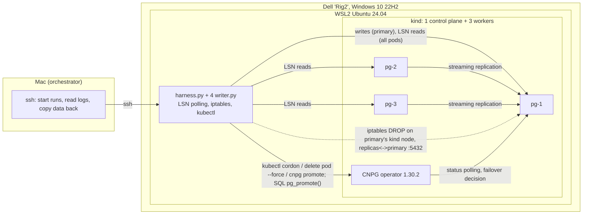

Regenerated 2026-11-23 from cnpg-results.csv and run artefacts after the original was overwritten in a cross-session file collision.

# CloudNativePG: Failover Gate full study report

Stack: CloudNativePG operator **1.30.2** on PostgreSQL **17.11**, kind v0.33.0 (Kubernetes v1.34.11) in WSL2 on the Dell rig, 2026-11-22/23. Versions as run are from `cnpg-SETUP.md` (read from the running system there). Every figure below comes from `cnpg-results.csv` (identical to `cnpg-runs/results.csv`), the per-run files in `cnpg-runs/runs/`, `progress-cnpg.log` or `cnpg-SETUP.md`. Tables were produced by running the study's own `cnpg-runs/bin/analyze.py` (`python3 -I`, read-only) plus a few direct CSV queries. The original report's narrative is unrecoverable; where it would have gone beyond the data, this file says only what the data shows.

## Summary

- **No lag gate showed on any measured path.** In 70 valid runs the operator promoted a replica every time, silently (no refusal or lag text in command output or operator log by the harness regex, `outcome` = `promoted_silent` 70/70).
- **Automatic failover (B) promoted 10/10 at 10 MiB and 10/10 at 100 MiB.** Loss was the whole gap: 1,152 to 1,180 acknowledged transactions per run at 10 MiB, 11,763 to 11,778 at 100 MiB. The operator promoted the replica with the smaller verified gap in 10/10 runs of each B cell. Nothing bounded how far behind that replica was.
- **Burst variant (Bb, 10 MiB only)** promoted 10/10, silent, loss 1,181 to 1,236. The gap formed in 1.07 to 1.30 s. There is no Bb cell at 100 MiB.
- **Operator promotion (C, `kubectl cnpg promote pg <replica>` with the primary pod already gone)** promoted 10/10 at 10 MiB (1,176 to 1,181 lost) and 10/10 at 100 MiB (11,759 to 11,776 lost), silent.
- **Bypass (D, `pg_promote()` on the replica)** returned in under a second and promoted 10/10 at each size (1,152 to 1,178 lost at 10 MiB, 11,736 to 11,773 at 100 MiB). In 20/20 runs the operator then shut the promoted pod down (see D below). The harness label `post_state` = `demoted_after` is 20/20, but the label is set by connection errors, not by observing the node back in recovery.
- **Operator's own status view was exact before the fault**: `kubectl cnpg status` reported each replica's Current LSN equal to its true received LSN in 70/70 valid runs (0 bytes error). That is a pre-fault reading with writers stopped; it says nothing about staleness under load. After the primary is gone the status output has no primary to report lag against.
- No E cells: the scenario was not run on this stack (see Scenario mapping).
- **70 valid / 76 attempts** (6 invalid, all in D 10 MiB), plus 6 aborted partial runs that never wrote a CSV row. Recount from stored files matched 70/70.

## What talks to what

Walkthrough: the Mac only starts runs and copies data back. The harness inside WSL writes to the primary pod and reads LSNs from every pod directly. It cuts replication with iptables DROP rules on the primary's kind node (both directions, replica to primary port 5432), so the primary keeps accepting writes while the replicas receive nothing. When the gap reaches the target the writers stop, the harness re-reads the LSNs, then cordons the primary's node and force-deletes its pod; the stall rules stay in place. The harness then lets the operator act (B, Bb), runs `kubectl cnpg promote` (C), or calls `pg_promote()` on the replica (D). Source: `cnpg-SETUP.md` diagram and `cnpg-runs/bin/harness.py`.

## Scenario mapping

| Scenario | What the harness does | failoverDelay |
|---|---|---|
| B | Gap grows over about 15 s (15.35 to 15.74 s measured in B cells); primary pod deleted; operator fails over unaided | 0 |
| Bb | Same, but writers jump to a high rate once the stall starts (supplementary, 10 MiB only; gap formed in 1.07 to 1.30 s) | 0 |
| C | Primary pod deleted; `kubectl cnpg promote pg <candidate>` where candidate is the replica with the smaller verified gap | 300 |
| D | Primary pod deleted; `select pg_promote(true, 60)` on the candidate; post-promotion state observed for 30 polls | 300 |
| E | **Not run.** There is no E driver and no E rows in the CSV. Reason (inferred, not tested): the Patroni E cut severs the replica's path to a separate DCS; in this CNPG deployment the operator and instance managers coordinate through the Kubernetes API, so there is no separable status path to cut independently of replication. | n/a |

`failoverDelay` was set to 300 s for C and D so the automatic path would not race the manual action (`harness.py`, `driver.py` `set_delay`); it was 0 (the operator default) for B and Bb. This is a configuration difference between scenarios and is labelled as a deviation below.

## Results (valid runs, 10 per cell)

Source: `analyze.py` output and CSV columns. "Gap" is the LSN-verified gap of the candidate replica, read after the writers stopped (`gap_cand_bytes`); ratio = verified gap / target.

| Cell | promoted | outcome | gap MiB (min - med - max) | acked lost txns (min - med - max) | WAL lost MiB (min - max)* | time to promotion s (min - med - max) |
|---|---|---|---|---|---|---|
| B 10 | 10/10 | silent | 10.00 - 10.02 - 10.03 | 1152 - 1179 - 1180 | 10.00 - 10.03 (8 runs) | 4.5 - 5.0 - 6.3 |
| B 100 | 10/10 | silent | 100.02 - 100.09 - 100.14 | 11763 - 11769 - 11778 | 100.02 - 100.13 (6 runs) | 4.8 - 5.4 - 23.6 |
| Bb 10 | 10/10 | silent | 10.04 - 10.21 - 10.50 | 1181 - 1200 - 1236 | 10.04 - 10.50 (4 runs) | 22.4 - 22.8 - 23.9 |
| C 10 | 10/10 | silent | 10.00 - 10.03 - 10.03 | 1176 - 1180 - 1181 | 10.00 - 10.03 (10 runs) | 5.8 - 6.1 - 23.4 |
| C 100 | 10/10 | silent | 100.01 - 100.06 - 100.13 | 11759 - 11766 - 11776 | 100.03 - 100.13 (4 runs) | 5.7 - 6.2 - 7.6 |
| D 10 | 10/10 | silent; `demoted_after` 10/10 | 10.00 - 10.01 - 10.02 | 1152 - 1154 - 1178 | 10.00 - 10.02 (10 runs) | 4.7 - 4.9 - 6.1 |
| D 100 | 10/10 | silent; `demoted_after` 10/10 | 100.00 - 100.10 - 100.19 | 11736 - 11750 - 11773 | 100.00 - 100.19 (10 runs) | 4.4 - 4.8 - 5.6 |

\* `lost_bytes_est` = primary WAL position at fault minus the promoted node's timeline fork LSN. It exists only for runs where the fork LSN was read; the number of runs is in brackets. 18 valid runs have no fork LSN (see Invalid runs and flaws). Acked-lost counts do not depend on it.

Time to promotion is from the force-delete of the primary pod to the new primary being ready (`t_promoted_s`). Medians are as printed by `analyze.py`.

Denominators (valid runs; acked = COMMIT returned to a writer; lost = acked and absent from the promoted node at promotion):

| Cell | acked writes (sum) | acked lost at promotion (sum) | runs with loss |
|---|---|---|---|
| B 10 | 16,972 | 11,763 | 10/10 |
| B 100 | 167,566 | 117,697 | 10/10 |
| Bb 10 | 14,525 | 12,003 | 10/10 |
| C 10 | 15,996 | 11,793 | 10/10 |
| C 100 | 160,137 | 117,674 | 10/10 |
| D 10 | 16,440 | 11,580 | 10/10 |
| D 100 | 162,156 | 117,510 | 10/10 |

Gap verification: slow-cell ratios were 1.000 to 1.003 (B 10, B 100: 1.000 to 1.001; C 10: 1.000 to 1.003; C 100: 1.000 to 1.001; D: 1.000 to 1.002). Bb ratios were 1.004 to 1.05. All valid runs are within +/-25% of target. Both replicas were in sync before the stall in every valid run (`pre_fault_in_sync_bytes` = 0). The other replica's gap was 10.16 to 10.60 MiB (10 MiB cells) and 101.62 to 103.29 MiB (100 MiB cells). Where the fork LSN was read, it equalled the candidate's verified receive LSN in 52 of 52 runs.

Which replica the operator promoted (B, Bb): the one with the smaller verified gap in 10/10 in each cell; the two replicas differed by 0.20 to 0.31 MiB (B 10), 1.75 to 3.25 MiB (B 100), 0.09 to 0.17 MiB (Bb 10).

## What gates exist per path

What the data shows, by path. "Observed" means a refusal or lag text did not appear in these runs; it does not prove no check exists in the code.

| Path | Gate observed | Evidence |
|---|---|---|
| Automatic failover (B, Bb) | none at 10 or 100 MiB | 30/30 promoted silent |
| `kubectl cnpg promote` (C) | none at 10 or 100 MiB | 20/20 promoted silent; command output was only "Node pg-X in cluster pg will be promoted" plus a log line "Cluster has become unhealthy" (C 100 r01 read in full; `cmd_output_flags` and `log_flags` empty in all valid rows) |
| `pg_promote()` (D) | none (outside the operator) | 20/20 promoted; the operator then acted on the node, see below |

From the documentation as read (v1.30.2 `docs/src/failover.md` and `instance_manager.md` in the project's repository, fetched in this regeneration session via a fetch agent, not independently re-read): the docs state "When synchronous replication is not enabled, some data loss is expected and accepted during failover"; they describe no lag bound on the default asynchronous path; an unready pod is ineligible for promotion in automated failover; an optional readiness probe of `type: streaming` with `maximumLag` can exclude a replica from promotion during failover. That probe was not configured in this study (`pg.yaml` sets none), so the study does not test it. Synchronous replication was not enabled (asynchronous streaming, `cnpg-SETUP.md`).

## Reported vs true lag

- **Operator's own view, pre-fault.** `kubectl cnpg status` was captured after the writers stopped and before the fault (`cnpg_status_prefault.txt`). Its Current LSN column equalled the harness's verified receive LSN for both replicas in all 70 valid runs: maximum absolute error 0 bytes, so the CSV's operator-view gap (`opview_gap_*`) equals the true gap in every row. Example (B 100 r01): primary 361685600; pg-1 254977816; pg-3 256808592, equal to the verified `recv` values.
- **Caveat on that result.** The primary's position here is read from the live primary, not from a published value, and writers are stopped. This does not show the operator's view is accurate at decision time under load. It also does not test a published or cached leader position the way the Patroni and pg_auto_failover comparisons do; no equivalent staleness was observed.
- **At decision time** (about 3 s after the primary pod is deleted) the primary is gone, so no lag against it can be reported. In the status output captured then, the streaming-replication section read "Not available" in B 10 (8/10 runs) and B 100 (5/10), and in none of the Bb, C or D runs; the "Primary instance not found" line appears in the sample C 100 r01 output. The per-replica Current LSN readings in the post-fault status matched true received LSN (0 bytes error, 12 to 20 readings per cell).
- The CSV supports no reported-vs-true error figure beyond these.

## What the operator and the person at the keyboard see

- C: `kubectl cnpg promote` returns immediately with one line ("Node pg-3 in cluster pg will be promoted", plus an informational JSON log line). Nothing about the 100 MiB (about 11,764 transaction) loss appears. Read in C 100 r01.
- B: no command is issued. The operator logs and k8s events were captured (`operator.log`, `events_k8s.txt`); the harness regex found no lag-related text in the failover lines.
- D: see next section.

## D: what happened after the bypass (20/20)

- `pg_promote()` returned true in about 0.7 s (D 100 r01: "pg_promote -> True in 0.70s") and the candidate accepted writes; survivors and the timeline history were read from the candidate immediately (`early read`) because the operator removes it within seconds.
- In 20/20 runs the candidate pod's `restartCount` was 1 (`cand_pod_state.txt`). In D 100 r01 its previous container terminated with exit code 0, finishing about 5 s after the promote, and the instance manager's log shows "postmaster exited", "server stopped" and "Old primary shutdown complete" on pg-3. In that run the cluster status still named the deleted pod (pg-1) as current and target primary throughout the observation ("Cluster in healthy state"), with the operator logging "Waiting for the failover delay to expire". I read only that run's logs in full.
- The harness polled the candidate for 30 polls (about 68 s). In all 600 polls (20 runs x 30) the connection failed (`conn_err`); in-recovery state was never read as true. The first connection error came 5.6 to 7.4 s after the fault in D 10 and 5.7 to 6.5 s in D 100. So `demoted_after` 20/20 means "the operator stopped the promoted node", not "observed re-entering recovery". This is a difference from the Patroni pilot, where the node was seen as a replica again.
- Each D run rebuilt the cluster afterwards (by design, as in the pilot), so there is no final-leader reading. The shakedown run recorded recovery taking 227 s and one shakedown rebuild after more than 420 s with the cause not captured (`progress-cnpg.log`, not counted).

## Deviations from the brief and the pilot (all labelled)

1. **Storage on tmpfs.** The Dell's disk is a 7200 rpm HDD (`dd oflag=dsync bs=8k` about 93 ms per fsync, about 11/s, capping four writers near 20 txn/s). A 5 GB tmpfs was mounted over `/var/local-path-provisioner` on each worker. PostgreSQL settings are defaults with fsync on (`pg.yaml` sets `max_connections` 100 only). Commits are fast; data does not survive a WSL restart.
2. **kind, not a physical cluster:** 1 control plane + 3 workers, one PostgreSQL instance per worker (required pod anti-affinity). Same physical host.
3. **`failoverDelay` 0 for B/Bb, 300 for C/D.**
4. **Fault** = cordon the primary's node and force-delete its pod, with the stall rules left in place. This is pod loss, not process kill.
5. **WSL2 networking, loopback-class.** Harness connects to pod IPs with SSL disabled over routed pod CIDRs; the only LAN hop is the Mac-to-Dell ssh. Replication traffic never leaves the machine.
6. **Replication cut** by iptables DROP on the primary's node rather than a TCP proxy stall. Verified per run by the LSN readings and the iptables counters (`iptables_counters.txt` in runs where captured).
7. **Gap size and loss unit.** Writers insert one 8,000-byte row per transaction; transaction counts scale with that (about 8,850 WAL bytes per txn in the pilot's calibration; this rig's value is in `cnpg-runs/bytes_per_txn`, read as 8932.1). Comparisons across stacks should use MiB.
8. Operator defaults otherwise: asynchronous streaming, replication slots on, `enableSuperuserAccess` true for the harness, resources requested 250m CPU / 512Mi, no limit.

## Invalid runs and flaws (6 invalid of 76 attempts; 6 aborted partials)

All six invalid rows are in D 10 MiB (16 attempts to get 10 valid). None dropped.

| Run | Reason (from `invalid_reason`) |
|---|---|
| D-10MB-r01 | rig exception: `DuplicateTable` (table `t_d_10mb_r01` already existed) |
| D-10MB-r02, r03 | harness defect: the operator shut the promoted candidate down within about 4 s, before survivors were read, so loss was not measurable from stored files |
| D-10MB-r04 | same harness defect; also the replica gap grew for 40.35 s (stall possibly ineffective for one replica) |
| D-10MB-r05 | rig exception: `DuplicateTable` (`t_d_10mb_r05`) |
| D-10MB-r06 | replicas not streaming and in sync at stall start (pg-3 had no walreceiver) |

- **Harness fix at the C 100 / D boundary** (`progress-cnpg.log`): driver 1 was stopped after C 100 finished; a partial D-10MB-r01 was moved aside; driver 2 added the "early read" of survivors and made the fork-LSN query wait until the node leaves recovery. Six partial run directories (`runs/_partial_*`) are the aborted attempts; none has a CSV row.
- **18 valid runs have no fork LSN**: B 10 r09 and r10, B 100 r01 to r04, Bb 10 r05 to r10, and C 100 r01 to r06. Their loss counts still recompute from the stored acked and surviving lists. `progress-cnpg.log` mentions only 12 earlier B/Bb runs lacking it; the six C 100 runs also lack it in the CSV and in the run files (empty "fork" in the C 100 r01 events log). The "WAL lost MiB" column therefore covers fewer runs in B 10, B 100, Bb 10 and C 100.
- **Shakedown runs** (`runs/shake-*`, 5 runs) are not counted.
- `D-10MB` valid runs and D 100 runs ran under the second driver after the fix; B, Bb, C ran under the first.

## Limits and what was not tested

- One host (the Dell: i7-8700, 32 GB, Windows 10 22H2), WSL2 + kind, tmpfs storage, async only, one version (operator 1.30.2, PostgreSQL 17.11).
- Not run: scenario E; a Bb cell at 100 MiB; gaps formed in under 1 s (the fastest Bb gap here was 1.07 s, at 10 MiB); synchronous replication; the optional `maximumLag` readiness probe; non-default `failoverDelay` on B; real network faults; a primary process kill instead of pod deletion; D observation beyond about 68 s.
- Timing columns include operator reconcile intervals and kind scheduling; they are not a measure of PostgreSQL promotion work.
- The 100 MiB B result is not a statement that CNPG can never refuse: it says no refusal occurred in 10/10 runs with this configuration. The documentation search for a lag bound found none on the default path; that search was by fetch agent and the plugin page was truncated (unverified for the remainder of the page).
- Timestamps: the CSV and run events are on the Dell's clock; `progress-cnpg.log` lines with a "T" separator are Dell-local and the "ALL CELLS DONE" line is Mac-local (inferred two-hour offset, consistent with the SETUP note of a 17:46 Dell-time boot against 15:45 Mac time).

## Evidence and reproduction

`cnpg-results.csv` (77 lines incl. header), `cnpg-runs/results.csv` (identical), `cnpg-runs/runs/<id>/` (`events.log`, `acked_w*.csv`, `acked.txt`, `surviving_at_promotion.txt`, `lost_ids.txt`, `gap_verified.json`, `cnpg_status_prefault.txt`, `cnpg_status_after_fault.txt`, `operator.log`, `timeline_history.txt`, and for C `promote_cmd.txt`, for D `pg_promote.txt`, `post_promote_obs.json`, `operator_after.log`, `cand_pod_state.txt`, `pg-*_postgres_previous.log`), `cnpg-runs/bin/` (`harness.py`, `driver.py`, `lib.py`, `writer.py`, `analyze.py`), `cnpg-runs/pg.yaml`, `cnpg-runs/kind.yaml`, `cnpg-SETUP.md`, `progress-cnpg.log`. Recount: `python3 -I cnpg-runs/bin/analyze.py <study folder>` recomputed loss and SHA-256 of both lists for 70 promoted valid runs from the files: 70 match, 0 mismatch (re-run for this regeneration). Rerun a cell with `bin/driver.py C:10 10` inside WSL on the Dell.

## Completion note

- **Did:** regenerated this report from the CSV, the run files, `cnpg-SETUP.md` and `progress-cnpg.log`; re-ran the study's analysis script and several direct CSV queries; read the C 100 r01 and D 100 r01 runs in full.
- **Found:** no lag gate on automatic, operator or bypass paths at 10 and 100 MiB; the operator picks the more advanced replica but admits any gap; the operator stops a bypass-promoted node within seconds; the operator's status LSNs were exact pre-fault; the log under-counts the runs lacking fork LSNs (18, not 12).
- **Blocked / unverified:** the original narrative; E cells; Bb at 100 MiB; whether any CNPG setting beyond defaults would gate promotion; the documentation reading was by fetch agent.
