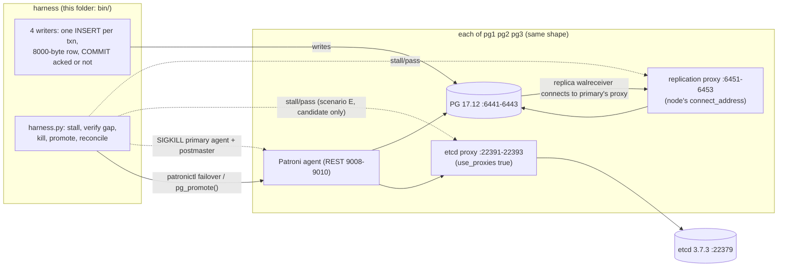

# Failover Gate pilot: PILOT-REPORT

Date: 2026-11-22. Status: **ROUND 2 COMPLETE. Bar verdict: CONTINUE to full study (first branch of the bar).** Round 1 (step-0 stop) is kept below.

## Summary (Round 2)

- **Verdict by the brief's bar: CONTINUE.** Manual `patronictl failover` (C) promoted the chosen replica with no refusal and no lag warning in **10/10 runs at the 10 MB target and 10/10 at the 100 MB target**, losing the whole gap each time (C: 1,188 to 1,191 acknowledged transactions per run at 10 MB, 11,881 to 11,898 at 100 MB). Bar needs >= 8/10. E (replica DCS path cut, then manager promotion) did the same: 10/10 and 10/10.
- The second CONTINUE branch (E reported-vs-true lag error >= 10 MiB in >= 5/10) is **not met** in the primary E cells: 0/10 at 10 MB, 3/10 at 100 MB. The KILL bar is not met either: C refused or warned in 0/10 (KILL needs >= 8/10). No "between" case.
- Automatic failover (B) behaves as a safeguard only when the gap builds slowly. With the gap growing over ~15 s, both replicas refused to promote in 20/20 runs ("My wal position exceeds maximum replication lag"), and the old primary came back with zero loss. In a supplementary cell where the same 10 MB gap forms in under a second (Bjb), Patroni **auto-promoted silently in 10/10 runs** and lost 10 to 11 MiB each time (1,160 to 1,307 txns). Cause, measured: Patroni compares the replica's live position with the leader position last written to the DCS, and that value was 24 to 287 MiB older than the replica's position, so the computed lag was negative.
- Direct `pg_promote()` (D) works instantly (1.6 s) with the full loss. In the run I read, Patroni demoted the node again about 2 s later; in 20/20 runs the node was a replica again 15 s later. The DCS leader key was still held by the dead primary in 20/20.
- 110 valid runs: 80 primary (B, C, D, E x 10 MB and 100 MB, 10 each), 30 supplementary. 24 attempts invalid, all logged (20 are an E design failure I found and fixed; see Invalid runs).
- Caveats that matter: one stack (PG 17.12, Patroni 4.1.5, etcd 3.7.3), one host, loopback, async replication, 3 nodes. The lag is made by stalling a TCP proxy, not by a real network fault. The primary runs repeat on a fixed ~60 s cycle, so the DCS-view lag error is partly phase-locked to Patroni's 10 s loop; the supplementary phase-jittered E cell (Ej) shows how much (see Reported vs true lag).

## Baseline from round 1

The author's failover paper (local draft v3, 18 Nov 2026; Zenodo record not verified, see Round 1) reports the zero-lag baseline: PostgreSQL/Patroni defaults lost one acknowledged transaction in each of 2 of 30 runs, out of 270,676 acknowledged writes, at near-zero shipping lag on loopback with process kill. Round 2 here asks a different question: what promotion paths admit when the candidate has not received 10 or 100 MiB. Same stack family, same host class; not the same workload or fault (primary host loss here).

## Setup

What talks to what (all on one Mac, loopback). Dotted lines are the harness cutting a path. The replication and DCS proxies are my additions to make the cuts possible; they are pass-through otherwise.

Walkthrough: each Patroni agent supervises its PostgreSQL and talks to etcd through its own proxy. Replicas stream WAL by connecting to the primary's `connect_address`, which is the primary's replication proxy. Stalling that proxy freezes shipping to both replicas while the primary keeps accepting writes. For scenario E the candidate agent's etcd proxy is stalled too, so only its DCS path is cut. The harness reads LSNs straight from each PostgreSQL port, kills the primary, then triggers the promotion path. (Connections are as built and read from `bin/cluster-up.sh`; the stall behaviour is as tested, see Lag mechanism.)

Versions (run, not recalled): PostgreSQL 17.12 (`postgres --version`), Patroni 4.1.5 (`patroni --version`), etcd 3.7.3 (`etcd --version`), macOS 15.5 arm64 (from the lab notes). Rig: copied and adapted from `~/postgres-failover-lab/bin` into `bin/`; the lab was not modified. Docker was not used.

Configuration: Patroni defaults (`ttl 30`, `loop_wait 10`, `retry_timeout 10`, `maximum_lag_on_failover 1048576` = 1 MiB, `primary_start_timeout 300`, async). **Deviations, all labelled:**

1. Own port range (PG 6441-6443, REST 9008-9010, etcd 22379). The lab's default ports (2379, 8008-8010, 5442/5443) are held by clusters from other projects (`patent-chaos`, `range-syndrome`); I did not touch them.
2. `postgresql.connect_address` points at a per-node TCP proxy and `etcd3.host` at a per-node etcd proxy. All runs.
3. `etcd3.use_proxies: true` (stops Patroni from discovering and using etcd's real URL). **Only in the E, Ej and Bjb runs and the final cluster builds; B, C, D (60 runs) and the 20 invalid E0 runs ran without it**, talking to etcd directly (their proxy path was pass-through or bypassed). Neither the B, C nor D scenario cuts the DCS path, so I do not expect this to matter, but it is a difference.
4. `use_pg_rewind: true` and `initdb --data-checksums`, as in the lab (needed so a dead primary can rejoin). Patroni's default for `use_pg_rewind` is false.
5. `pg_hba` trust on loopback; fixed passwords in the generated configs.
6. Fault = SIGKILL of the primary's **postmaster and Patroni agent together** (host loss). I chose this so a promotion decision is actually forced under the default `primary_start_timeout` (300). I did not test killing only the postmaster; the lab notes mention a `PST=0` setting for failover cells, and I did not verify their reason.
7. Runs reuse one cluster. After B, C, E the old primary's agent is restarted and Patroni rejoins it; after D the cluster is rebuilt from scratch (the bypass leaves a diverged node).

Load: 4 writer processes, one autocommit INSERT of an 8,000-byte `bytea` per transaction (about 8,850 WAL bytes per txn, calibrated on the first runs). Rate capped so the gap grows over ~15 s (measured 15.2 to 16.3 s over the 80 primary runs): ~79 txn/s total for 10 MB, ~790 for 100 MB. Burst variant (Bjb) uncapped.

## Lag mechanism and how the gap was verified

Mechanism: a small TCP proxy (`bin/tcpproxy.py`) sits on each node's `connect_address`. `stall` stops reading on every open connection in both directions, so bytes stay in kernel buffers, holds new connections without opening the upstream leg, and defers close propagation. WAL not yet forwarded is therefore not received. Patroni's agent on the replica stays live and reachable (REST, and DCS unless scenario E cuts it). No lag is induced by replay delay.

Per-run procedure and verification (events in `runs/<id>/events.log`):

1. Writers run ~3 s at the capped rate; harness records candidate gap (about 0).
2. Stall the primary's replication proxy (E also stalls the candidate's etcd proxy). Poll the primary's `pg_current_wal_lsn()` and the candidate's `pg_last_wal_receive_lsn()` every ~20 ms.
3. When gap >= target, stop the writers, wait for them to exit, and re-read both LSNs plus both replicas' receive and replay LSNs. **That reading is the verified gap**, taken ~0.2 s before the kill. Target is 10 MiB or 100 MiB; a run outside +/-25% is invalid.
4. Cross-check after promotion: the fork LSN from the new node's timeline history file equals the verified receive LSN of the promoted node in 88 of 90 promoted runs. One differs by 160 bytes (partial record, Bjb-10MB-r01). The other, Bjb-10MB-r13, is a weakness in my verification: the burst load left the proxy's own write buffer to one replica undrained, so that replica's receive LSN was read 83 MB short while it was still draining; the fork LSN shows the true cut, and the run's loss bytes use the fork LSN.
5. Primary runs: verified gap / target = 1.000 to 1.003 (80 runs).

"MB" in this report means MiB (1,048,576 bytes), the unit Patroni's 1 MB default is in.

## Per-scenario results (primary cells, 10 valid runs each)

Raw counts and per-run arithmetic are in the generated tables at the end (`results/summary.md`, produced by `bin/analyze.py` from `results/results.csv`). Short form:

| Scenario | Path | 10 MB target | 100 MB target |
|---|---|---|---|
| B control | primary dies, automatic failover | **refused 10/10** (no promotion in 90 s; old primary rejoined, 0 lost) | **refused 10/10** (same) |
| C | primary dies, `patronictl failover --candidate X --force` | **promoted 10/10, silent**, 1,188 to 1,191 txns lost per run | **promoted 10/10, silent**, 11,881 to 11,898 lost per run |
| D | primary dies, `pg_promote()` on X | **promoted 10/10, silent**, 1,188 lost per run | **promoted 10/10, silent**, 11,876 to 11,893 lost per run |
| E | replica DCS path cut while gap grows, restored, primary dies, `patronictl failover` | **promoted 10/10, silent**, 1,180 to 1,190 lost per run | **promoted 10/10, silent**, 11,877 to 11,897 lost per run |

(Loss ranges above are read from the denominators table; "silent" = no refusal and no lag-related warning text in the command output or the replicas' Patroni logs, matched by regex, see `outcome` in the CSV.)

What I observed per scenario:

- **B.** Both replicas logged "My wal position exceeds maximum replication lag" every loop until the 90 s limit; no promotion. When I restarted the old primary's agent, it resumed leadership and the final leader had every acknowledged write (`acked_lost_final` 0 in 20/20). So the safeguard held, but only because the DCS leader position was fresh enough; see Bjb below.
- **C.** `patronictl` could not reach the dead leader's REST API ("Could not failover using Patroni api, falling back to DCS"), wrote the failover request to the DCS, exited 0 and the candidate promoted in 22.7 to 29.8 s (inferred: waiting out the 30 s leader-key TTL). The topology table printed before the request shows the candidate's Lag column (5 to 10 at the 10 MB target; 54 to 96 at 100 MB) but there is no gate or warning; the run used `--force`, so no confirmation prompt was exercised. Reading the 4.1.5 source (`ha.py manual_failover_process_no_leader`, `api.py is_failover_possible`), manual failover calls the health check with `check_replication_lag=False` and the API check only filters on member limitations; I did not read `failover_limitation()`.
- **D.** `pg_promote()` returned in 1.6 s; the node accepted writes. In the run I read (D-10MB-r05) Patroni logged "Demoting self (immediate-nolock)" about 2 s after the promote. In 20/20 runs the node reported role `replica` 15 s later with the dead primary still holding the DCS leader key. I did not test what happens if the bypass runs after the leader key has expired.
- **E.** In my design the DCS cut leaves the replica's published position equal to its true frozen position (the stalled receiver freezes it at the same point), so E's promotion and DCS view are essentially C's. All 20 valid E runs and all 20 Ej runs show 1 to 5 DCS errors (the `Request to server ... failed` lines) on the candidate agent's log during the cut, so the cut did bite.

## Reported vs true lag

Two Patroni views were recorded per run (DCS snapshot 0.4 s after the kill, stored in `runs/<id>/dcs_at_decision.json`):

- **DCS view**: leader `optime` minus the member's published `xlog_location`; what `patronictl list` shows.
- **Election view**: leader `optime` minus the candidate's live received LSN; what the automatic path compares to `maximum_lag_on_failover` (`ha.py is_lagging`). Computed post hoc from stored fields.

Both depend on the leader's `optime` in the DCS, which Patroni writes once per `loop_wait` (10 s). So "reported lag" is lag against the primary's position as of up to 10 s earlier. The per-cell medians and ranges are in the generated table "Patroni's two views". Highlights:

- Primary E: |DCS view - true| >= 10 MiB in 0/10 (10 MB) and 3/10 (100 MB); within 1 MiB in 7/10 and 0/10.
- The same gap gives different reported lag depending on where the kill falls in Patroni's loop: at 100 MB, true 100.1 MiB, DCS view median 94.7 (C) and 94.3 (E) but 54.4 (D) and 53.4 (B). The back-to-back primary runs repeat on a ~60 s cycle, so this is partly phase-locking, not a scenario effect.
- Supplementary Ej (E with a random 0 to 10 s delay before the stall): error >= 10 MiB in 0/10 at 10 MB and **7/10 at 100 MB** (one run replaced, see Invalid runs). If the PM accepts Ej in place of E, the second CONTINUE branch is also met at 100 MB; that is not part of the stated verdict.
- Supplementary Bjb (B, burst growth, random phase delay): election view -287 to -25 MiB in 10/10 (the DCS leader position was behind the replica's live position), all 10 below the 1 MiB limit, all 10 promoted silently. Primary B election view 6.3 to 60.7 MiB in 20/20, all above the limit, all 20 refused. The two sets agree with the rule, which supports the mechanism.

## Bar verdict (arithmetic)

Numbers from `results/summary.md` "Bar arithmetic" (true loss = verified WAL bytes lost >= 10 MiB, promoted, outcome `promoted_silent`).

| Test | 10 MB target | 100 MB target | Needs |
|---|---|---|---|
| C promotes, loss >= 10 MiB, no refusal/warning | 10/10 | 10/10 | >= 8/10 (**met**) |
| E promotes, loss >= 10 MiB, no refusal/warning | 10/10 | 10/10 | >= 8/10 (met) |
| E \|reported - true\| >= 10 MiB | 0/10 | 3/10 | >= 5/10 (not met) |
| C refused or warned | 0/10 | 0/10 | >= 8/10 for KILL (not met) |
| E reported within 1 MiB of truth | 7/10 | 0/10 | >= 8/10 for KILL (not met) |

CONTINUE branch 1 is met at both targets, so **CONTINUE**. KILL is not met at either. D is not used in the verdict (the brief says it cannot carry the study alone); C and E each qualify on their own. The PM only needs to adjudicate if the PM reads "no refusal or warning" more strictly than the regex and log check I used (C runs used `--force`, and the printed topology table shows the candidate's lag column).

## Invalid runs (24 of 134 attempts, none dropped)

| Runs | Reason |
|---|---|
| E0, 20 runs (10 at 10 MB, 10 at 100 MB), `runs/E0-*` | **DCS cut ineffective.** Patroni's etcd3 client discovers etcd's real client URL and bypassed my proxy, so the replica agent kept heartbeating during the "cut". Found when the candidate's log showed normal loop lines inside the cut window. Fixed with `etcd3.use_proxies: true`, verified (read timeouts to the proxy during a manual stall), and E re-run from scratch. Their promotions were silent, loss as in C; they are effectively extra C runs. |
| Ej-10MB-r03 | Evidence contaminated: primary held 1,956 rows vs 964 acked. Orphan writer processes from an attempt I had killed mid-run kept inserting into the same-named table. Caught by the `acked_total` vs `primary_rows_before_fault` check, which matches in every other valid run. Replaced by Ej-10MB-r11. |
| Bjb-10MB-r06, r09 | Gap off target (18.7 MB, 45.6 MB vs 10.0): burst load outran the 20 ms poll. |
| Bjb-10MB-r11 | Rig: `No space left on device` (disk at 99%). Cluster rebuilt to free space. |
| aborted attempts | Two Ej attempts killed with the E0 batch are under `runs/aborted-supp-ineffective-cut/` and are not in the CSV. |

Shakedown runs (harness development, not counted) are in `runs/shakedown/` and `results/shakedown/`. They exposed a bug (a restarted agent's pid file held a wrapper shell's pid, so one "kill" missed the agent) which was fixed before the counted runs. Two shakedown runs (`D-10MB-r01`, `C-100MB-r01`) ran on the final fault logic and are kept as r01 of their cells.

## Limits and what I did not verify

- One stack, one host, loopback, 3 nodes, async. The study's other stacks (CloudNativePG, pg_auto_failover) were not run.
- The gap is made by a proxy stall, not by network loss or a slow link. The writers run at 8.8 KB per txn, much larger than a typical OLTP row, so "txns lost" scales with that.
- "No warning" is by regex over command output and replica logs plus a read of the DCS state. I did not read Patroni's interactive confirmation path (runs used `--force`).
- The 30 s promotion time in C/E is inferred as the leader-key TTL, not isolated.
- Bjb-10MB-r13 shows burst load can leave a replica 87 MB behind before the stall; Bjb is a supplementary stress cell, not a calibrated one.
- Primary runs are phase-locked to Patroni's loop; see Reported vs true lag.
- The Zenodo version of the paper is still unverified (round 1 blocker).

## Evidence and reproduction

- `results/results.csv`: one row per attempt (134), all columns including SHA-256 of each list.
- `runs/<id>/`: `events.log`, `acked_w1..4.csv` (writer logs), `acked.txt`, `surviving_at_promotion.txt` (read from the promoted node right after promotion), `surviving_final.txt` (final leader after recovery; absent for D, cluster rebuilt), `lost_ids.txt`, `dcs_at_decision.json`, `patronictl_failover.txt` or `pg_promote.txt`, and slices of each Patroni log. Every loss number recomputes from `acked.txt` minus `surviving_at_promotion.txt`; `python3 -I bin/analyze.py` did this for all 90 promoted valid runs, and counts and hashes matched.
- Scripts in `bin/`: `cluster-up.sh`, `cluster-down.sh`, `tcpproxy.py`, `pxctl.sh`, `writer.py`, `harness.py`, `driver.py`, `analyze.py`. Logs: `results/driver*.log`.
- Cleanup: cluster stopped, all pilot processes and ports gone, `cluster/` (about 8 GB of data and logs) deleted; rebuild with `bin/cluster-up.sh`. Other projects' clusters on this Mac were not touched.

## Generated tables (from `bin/analyze.py`)

### Per-cell results (valid runs only; invalid listed separately)

| Cell | valid | promoted | refused/blocked | promoted + warning | promoted silent | verified gap MiB (min-med-max) | acked lost txns at promotion (min-med-max) | WAL bytes lost MiB (min-med-max) | Patroni reported lag MiB (med) | reported vs true error MiB (med abs) | time to promotion s (med) |
|---|---|---|---|---|---|---|---|---|---|---|---|
| B 10 MB | 10 | 0 | 10 | 0 | 0 | 10.00 - 10.00 - 10.03 | n/a | n/a | 6.3 | 3.7 | n/a |
| B 100 MB | 10 | 0 | 10 | 0 | 0 | 100.04 - 100.10 - 100.20 | n/a | n/a | 53.4 | 46.7 | n/a |
| C 10 MB | 10 | 10 | 0 | 0 | 10 | 10.00 - 10.00 - 10.03 | 1188 - 1188 - 1191 | 10.00 - 10.00 - 10.03 | 9.6 | 0.4 | 29.65 |
| C 100 MB | 10 | 10 | 0 | 0 | 10 | 100.06 - 100.13 - 100.20 | 11881 - 11888 - 11898 | 100.06 - 100.13 - 100.20 | 94.7 | 5.4 | 29.45 |
| D 10 MB | 10 | 10 | 0 | 0 | 10 | 10.00 - 10.00 - 10.03 | 1188 - 1188 - 1188 | 10.00 - 10.00 - 10.03 | 5.6 | 4.4 | 1.6 |
| D 100 MB | 10 | 10 | 0 | 0 | 10 | 100.04 - 100.08 - 100.16 | 11876 - 11884 - 11893 | 100.04 - 100.08 - 100.16 | 54.4 | 45.7 | 1.6 |
| E 10 MB | 10 | 10 | 0 | 0 | 10 | 10.00 - 10.00 - 10.03 | 1180 - 1188 - 1190 | 10.00 - 10.00 - 10.03 | 9.6 | 0.4 | 29.75 |
| E 100 MB | 10 | 10 | 0 | 0 | 10 | 100.02 - 100.14 - 100.19 | 11877 - 11890 - 11897 | 100.02 - 100.14 - 100.19 | 94.3 | 5.8 | 29.299999999999997 |
| Ej 10 MB | 10 | 10 | 0 | 0 | 10 | 10.00 - 10.00 - 10.03 | 1180 - 1188 - 1188 | 10.00 - 10.00 - 10.03 | 7.1 | 2.9 | 25.85 |
| Ej 100 MB | 10 | 10 | 0 | 0 | 10 | 100.01 - 100.08 - 100.21 | 11875 - 11884 - 11897 | 100.01 - 100.08 - 100.21 | 76.0 | 24.1 | 26.0 |
| Bjb 10 MB | 10 | 10 | 0 | 0 | 10 | 10.06 - 10.64 - 10.99 | 1160 - 1264 - 1307 | 10.06 - 10.64 - 10.99 | 6.5 | 11.0 | 25.65 |

### Denominators (valid runs; acked = COMMIT acknowledged to a writer, lost = acked and absent from the promoted node at promotion)

| Cell | valid runs | acked writes (sum) | acked lost at promotion (sum) | runs with loss | acked lost at end of run, final leader (sum) |
|---|---|---|---|---|---|
| C 10 MB | 10 | 14,280 | 11,883 | 10/10 | 11,883 |
| C 100 MB | 10 | 141,897 | 118,886 | 10/10 | 118,886 |
| D 10 MB | 10 | 14,280 | 11,880 | 10/10 | n/a (cluster rebuilt) |
| D 100 MB | 10 | 141,714 | 118,838 | 10/10 | n/a (cluster rebuilt) |
| E 10 MB | 10 | 14,271 | 11,873 | 10/10 | 11,873 |
| E 100 MB | 10 | 141,874 | 118,873 | 10/10 | 118,873 |
| Ej 10 MB | 10 | 17,632 | 11,872 | 10/10 | 11,872 |
| Ej 100 MB | 10 | 179,289 | 118,843 | 10/10 | 118,843 |
| Bjb 10 MB | 10 | 393,410 | 12,531 | 10/10 | 12,531 |

### Patroni's two views of the candidate's lag at decision time (MiB)

DCS view = leader optime in DCS minus the member's published xlog_location (what `patronictl list` shows). Election view = leader optime in DCS minus the candidate's live received LSN (what `ha.py is_lagging` compares in the automatic path). True = primary LSN at fault minus candidate received LSN. Limit = `maximum_lag_on_failover` = 1 MiB. Candidate for B/Bjb = the replica with the smaller true gap.

| Cell | true gap (med) | DCS view (min / med / max) | election view (min / med / max) | election view <= 1 MiB (would pass the limit) |
|---|---|---|---|---|
| B 10 MB | 10.0 | 6.3 / 6.3 / 9.1 | 6.3 / 6.3 / 9.1 | 0/10 |
| B 100 MB | 100.1 | 52.8 / 53.4 / 60.7 | 52.8 / 53.4 / 60.7 | 0/10 |
| C 10 MB | 10.0 | 5.0 / 9.6 / 9.7 | 5.0 / 9.6 / 9.7 | 0/10 |
| C 100 MB | 100.1 | 53.9 / 94.7 / 95.7 | 53.9 / 94.7 / 95.7 | 0/10 |
| D 10 MB | 10.0 | 5.5 / 5.6 / 9.7 | 5.5 / 5.6 / 9.7 | 0/10 |
| D 100 MB | 100.1 | 54.1 / 54.4 / 54.8 | 54.1 / 54.4 / 54.8 | 0/10 |
| E 10 MB | 10.0 | 5.0 / 9.6 / 9.8 | 4.5 / 9.6 / 9.8 | 0/10 |
| E 100 MB | 100.1 | 73.2 / 94.3 / 95.8 | 73.2 / 94.3 / 95.8 | 0/10 |
| Ej 10 MB | 10.0 | 4.0 / 7.1 / 10.0 | 4.0 / 7.1 / 10.0 | 0/10 |
| Ej 100 MB | 100.1 | 38.4 / 76.0 / 99.9 | 38.4 / 74.5 / 99.9 | 0/10 |
| Bjb 10 MB | 10.6 | -0.2 / 6.5 / 72.1 | -287.3 / -133.5 / -24.6 | 10/10 |

### Bar arithmetic

### Target 10 MB
- C: promoted, no refusal/warning, true loss >= 10 MiB: **10/10** (bar needs >= 8/10)
- E: promoted, no refusal/warning, true loss >= 10 MiB: **10/10** (bar needs >= 8/10)
- E: |reported - true| lag >= 10 MiB: **0/10** (CONTINUE alt. needs >= 5/10); within 1 MiB of truth: **7/10** (KILL needs >= 8/10)
- C: refused or warned: **0/10** (KILL needs >= 8/10 at >= 10 MB)
### Target 100 MB
- C: promoted, no refusal/warning, true loss >= 10 MiB: **10/10** (bar needs >= 8/10)
- E: promoted, no refusal/warning, true loss >= 10 MiB: **10/10** (bar needs >= 8/10)
- E: |reported - true| lag >= 10 MiB: **3/10** (CONTINUE alt. needs >= 5/10); within 1 MiB of truth: **0/10** (KILL needs >= 8/10)
- C: refused or warned: **0/10** (KILL needs >= 8/10 at >= 10 MB)

### Reported vs true lag, per run (abs error, MiB, sorted)

- B 10 MB: 1.0, 3.6, 3.6, 3.6, 3.7, 3.7, 3.7, 3.7, 3.7, 3.7
- B 100 MB: 39.4, 45.1, 45.5, 46.5, 46.6, 46.9, 46.9, 47.0, 47.1, 47.3
- C 10 MB: 0.3, 0.3, 0.3, 0.3, 0.4, 0.4, 3.4, 4.9, 4.9, 5.1
- C 100 MB: 4.4, 5.0, 5.1, 5.3, 5.3, 5.4, 5.6, 5.9, 6.0, 46.2
- D 10 MB: 0.3, 1.5, 4.3, 4.4, 4.4, 4.4, 4.4, 4.4, 4.4, 4.5
- D 100 MB: 45.2, 45.4, 45.6, 45.6, 45.6, 45.7, 45.7, 45.8, 45.9, 46.0
- E 10 MB: 0.2, 0.3, 0.3, 0.3, 0.4, 0.4, 0.4, 3.3, 5.0, 5.0
- E 100 MB: 4.3, 4.5, 4.5, 5.1, 5.1, 6.4, 7.3, 25.2, 26.0, 26.8
- Ej 10 MB: 0.0, 0.2, 0.8, 2.8, 2.8, 3.0, 4.2, 4.3, 5.8, 6.1
- Ej 100 MB: 0.1, 2.7, 4.9, 11.5, 13.3, 35.0, 53.4, 53.7, 54.3, 61.7
- Bjb 10 MB: 2.8, 10.3, 10.5, 10.8, 10.9, 11.1, 18.6, 34.3, 50.3, 61.6

### Supplementary cells (not part of the bar)

- Ej 10 MB: valid 10; promoted 10; refused 0; |reported-true| >= 10 MiB in 0/10; within 1 MiB in 3/10
- Ej 100 MB: valid 10; promoted 10; refused 0; |reported-true| >= 10 MiB in 7/10; within 1 MiB in 1/10
- Bjb 10 MB: valid 10; promoted 10; refused 0; |reported-true| >= 10 MiB in 9/10; within 1 MiB in 0/10

### E: was the DCS cut effective? (candidate agent log lines 'Request to server ... failed' / 'Error communicating' per run)

- E 10 MB: runs with >= 1 DCS error on the candidate's agent: 10/10 (counts [3, 4, 4, 2, 4, 4, 4, 2, 4, 4])
- E 100 MB: runs with >= 1 DCS error on the candidate's agent: 10/10 (counts [3, 4, 4, 4, 4, 5, 5, 4, 4, 4])
- Ej 10 MB: runs with >= 1 DCS error on the candidate's agent: 10/10 (counts [5, 3, 5, 3, 2, 1, 3, 4, 5, 3])
- Ej 100 MB: runs with >= 1 DCS error on the candidate's agent: 10/10 (counts [4, 2, 3, 3, 4, 3, 3, 4, 4, 3])

### Invalid runs

24 invalid of 134 attempts.
- 20 runs, scenario E0: DCS cut ineffective: Patroni etcd3 discovered the real etcd member URL and bypassed the proxy (replica agent kept heartbeating during the "cut")
- 1 runs, scenario Ej: evidence contaminated: primary had 1956 rows vs 964 acked; orphan writer processes from an earlier aborted attempt (killed driver) kept inserting into the same-named table. Detected by the acked_total vs primary_rows_before_fault check; all other runs match
- 1 runs, scenario Bjb: gap off target: 18688456 vs 10485760 (ratio 1.782)
- 1 runs, scenario Bjb: gap off target: 45558176 vs 10485760 (ratio 4.345)
- 1 runs, scenario Bjb: rig exception: OSError: [Errno 28] No space left on device

### Run-level recount check (acked - surviving, from stored files)

Recomputed loss and hashes for 90 promoted runs from files: all match.

## Step-0 evidence (round 1, kept as written)

Source read: `~/external-review/papers/03-db-failover.txt` (802 lines), "Client-Observed Write Unavailability After a Primary Process Kill: Five Replicated Database Systems at Shipped Settings on a Single Host", Sajish Krishnan, "Internal draft v3, 18 November 2026. Not for circulation." Status of this file as a copy of the published paper: unverified.

| Claim | Where in the text (quoted or paraphrased from what I read) |
|---|---|
| Per-kill reconciliation of every acknowledged write | Sec. 2: "Acknowledged IDs were reconciled in every run of every system." Classes: acknowledged-and-present, acknowledged-but-lost, committed-but-unacknowledged. |
| Lost writes reported for PostgreSQL/Patroni defaults | Abstract: "The PostgreSQL defaults cell ... lost one acknowledged transaction in each of 2 of 30 runs." Sec. 3.1: 2 of 30 runs, out of 270,676 acknowledged writes. Tuned-timing cell: none of 270,941. |
| Sibling PG cells | 1 in 1 of 30 runs (PostgreSQL 16.16); 2 in 2 of 20 (fourth node); 1 in 1 of 10 (same-session control); none in 20 (read-heavy mix). |
| Other systems | MongoDB, MySQL GR, Redis, CockroachDB: zero acknowledged writes lost, with denominators. |
| Limits that matter for this pilot | Sec. 3.1: "Cells with heavier write load, induced replica delay, a second fault or a stop signal instead of a kill are outside this paper; several of them lost acknowledged writes, so the loss counts below are not a bound on asynchronous loss in PostgreSQL." Limitation 2: loopback, "Replication lag is close to zero". Limitation 4: one fault type, process kill. |

What the paper does not do (from what I read): inject controlled lag at 10 or 100 MB, test a promotion safeguard or a lag limit, compare reported lag to true lag, or test manual `patronictl failover`, DCS-partition, or `pg_promote()` paths. I did not search the full text for every one of those terms; this list is from the sections I read (abstract, 3.1, tables, limitations, conclusion).

Prior knowledge worth flagging to the PM: Sec. 3.1 says induced-delay cells exist in the author's own data (`~/postgres-failover-lab`, not opened). Those may already hold relevant loss numbers. I did not open them.

## Round 1 verdict against the brief

Brief: "If it already reports lost writes per kill, STOP ... the PM must re-decide." The paper reports lost writes per kill. Stopped. I applied the brief literally and did not judge whether the narrower overlap above should override it. That call is the PM's.

## Blockers

1. Round 1: Zenodo record not found; local draft v3 used as the paper. Still open.
2. Docker was not needed and not used; I did not re-check whether its CLI is on PATH.
3. Round 2: none outstanding. Disk was the one resource problem (see Invalid runs).

## Completion note

- **Did:** read the round-2 brief, round-1 report, lab inventory and vetting; built a 3-node Patroni rig in this folder from the lab's scripts; ran 80 primary runs (B, C, D, E x 2 lag targets x 10 valid) plus 30 supplementary; verified the gap per run from LSNs on both servers; kept per-run acked and surviving lists with hashes; recomputed all loss numbers from the stored files; stopped and removed the cluster.
- **Found:** bar verdict CONTINUE. Manual failover and direct promotion admit the full 10 and 100 MiB gaps silently; automatic failover refuses slow-built gaps but promoted silently on a fast-built one in the supplementary cell. Reported lag is bounded by the DCS leader position's age, up to 10 s.
- **Blocked / unverified:** E design failure (20 runs) found and re-run; one contaminated supplementary run replaced; the supplementary cells are not calibrated for the bar; Zenodo paper version unverified.
