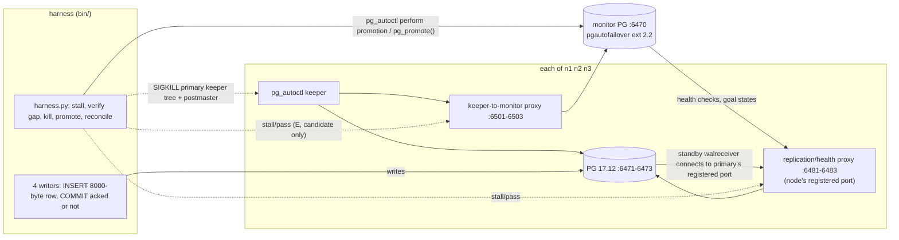

# pg_auto_failover: Failover Gate full study report

Date: 2026-11-22/23. Stack: pg_auto_failover **2.2** (release tag v2.2, built from source; `pg_autoctl --version` prints "pg_autoctl extension version 2.2") on PostgreSQL **17.12** (`postgres --version`), macOS 15.5 arm64. One host, loopback, async, 3 data nodes + 1 monitor.

## Summary

- **The stack has a real lag gate, and it works for slow-built gaps.** The monitor refuses to promote a standby whose last-reported LSN is more than `pgautofailover.promote_wal_log_threshold` (default 16,777,216 bytes = 16 MiB, read with `psql`) behind the primary's last-reported LSN. It applies on the automatic path (B) and on the operator path (C, E). I read the code (`group_state_machine.c`, `WalDifferenceWithin`) and the monitor log shows the refusal text on every refused run.
- **Result by size:** at the 10 MiB target the gap is under the threshold, so B, C and E promoted **silently in 10/10 each** and lost the whole gap (1,188 acknowledged txns per run, 10.00 to 10.03 MiB). At the 100 MiB target B, C and E were **refused 10/10 each** (no promotion in 150 s; zero acknowledged loss because the old primary was never replaced).
- **The bypass is not gated.** Direct `pg_promote()` (D) promoted in 1.5 s in 20/20 runs. What the stack did afterwards depends on size: at 10 MiB the monitor ended up **ratifying** the bypassed node as primary in 10/10 (full loss kept, silent); at 100 MiB the node's keeper **put it back into recovery** by 60 s in 10/10, and the monitor sat in `report_lsn` with no primary (state at 60 s only; I did not watch longer).
- **The burst variant did not beat the gate in what I could build.** At 10 MiB the burst gap formed in 0.4 to 0.7 s, but 10 MiB is under the 16 MiB threshold, so promotion is allowed anyway and the test says nothing about the gate (10/10 promoted, same as B). At 100 MiB the fastest burst I could generate took 1.9 to 4.6 s, not under 1 s; 10/10 refused. The Patroni "Bjb" result is therefore **neither replicated nor refuted** here at 100 MiB for gaps formed in under 1 s (see What I did not test).
- **Operator view when refused:** `pg_autoctl perform promotion` waits 60 s, then exits 12 ("Failed to wait until a new primary has been notified"). The command output has no lag text (regex check, `cmd_msgs` empty in 20/20 refused C/E runs); the reason ("more than pgautofailover.enable_sync_wal_log_threshold (16777216) behind the primary") appears only in the monitor log, 240 to 251 repeats per refused E run.
- 126 attempts, 6 invalid (all logged), 120 valid runs across 12 cells; recount from stored files matched for all 70 promoted valid runs.

## What talks to what

Walkthrough: each keeper reports its node's state and LSN to the monitor (through its own proxy) and obeys the goal state the monitor assigns. Standbys stream WAL from the primary's *registered* port, which is the replication proxy; stalling it freezes receipt on both standbys while the primary keeps accepting writes. The monitor's health checks to a node also go to that registered port (so they pass through the same proxy; see Deviations). For E the candidate keeper's path to the monitor is stalled instead of only replication. The harness reads LSNs straight from each PostgreSQL port, kills the primary's keeper process tree plus postmaster, then triggers the promotion path. Connections are as built (`bin/cluster-up.sh`); the monitor's reported-LSN gate is from the source, confirmed in the monitor logs.

## Scenario mapping to the pilot

| Pilot | This study | What it does |
|---|---|---|
| B | **B** | Automatic failover; gap grows over ~15 s (measured 15.3 to 15.7 s) |
| Bjb | **Bb** | Same, unthrottled writers, random 0 to 10 s delay before the stall. Gap formed in 0.4 to 0.7 s at 10 MiB, 1.9 to 4.6 s at 100 MiB |
| C | **C** | `pg_autoctl perform promotion --name X` with the primary dead |
| D | **D** | `pg_promote()` on X after the kill |
| E | **E** | Candidate keeper-to-monitor path cut while the gap grows, restored, primary killed, then `perform promotion` |
| (E as first run) | **Ea** | Same cut, **no** promotion command: automatic failover with the cut. Supplementary (see Invalid runs and flaws) |

## Results (valid runs, 10 per cell; full tables in `results/summary.md`)

| Cell | promoted | outcome | verified gap MiB (min-med-max) | acked lost txns (min-med-max) | monitor-reported lag, med MiB | abs error vs true, med MiB (max) | time to promotion s (med) |
|---|---|---|---|---|---|---|---|
| B 10 | 10/10 | silent | 10.00 - 10.00 - 10.03 | 1188 | 10.0 | 0.03 | 23.6 |
| B 100 | 0/10 | refused | 100.03 - 100.07 - 100.17 | 0 | 97.5 | 2.7 | n/a |
| Bb 10 | 10/10 | silent | 10.04 - 10.57 - 11.68 | 1192 - 1255 - 1386 | 5.6 | 5.1 (24.6) | 33.1 |
| Bb 100 | 0/10 | refused | 100.11 - 100.87 - 101.87 | 0 | 93.8 | 7.3 (29.2) | n/a |
| C 10 | 10/10 | silent | 10.00 - 10.00 - 10.03 | 1188 | 9.9 | 0.08 | 54.6 |
| C 100 | 0/10 | refused (rc 12 after 60 s) | 100.01 - 100.15 - 100.20 | 0 | 97.7 | 2.4 (3.7) | n/a |
| D 10 | 10/10 | silent, ratified by monitor 10/10 | 10.00 - 10.00 - 10.03 | 1188 | 10.0 | 0.03 | 1.5 |
| D 100 | 10/10 | promoted, then demoted-after (back in recovery by 60 s, 10/10) | 100.04 - 100.06 - 100.21 | 11879 - 11882 - 11899 | 97.7 | 2.5 (3.2) | 1.5 |
| E 10 | 10/10 | silent | 10.00 - 10.00 - 10.03 | 1188 | 10.5 | 0.54 | 54.5 |
| E 100 | 0/10 | refused (rc 12 after 60 s) | 100.02 - 100.11 - 100.19 | 0 | 102.3 | 2.3 (3.8) | n/a |
| Ea 10 | 10/10 | silent | 10.00 - 10.00 - 10.03 | 1188 | 10.5 | 0.54 | 23.2 |
| Ea 100 | 0/10 | refused | 100.01 - 100.11 - 100.17 | 0 | 102.5 | 2.8 | n/a |

Loss unit note: "acked lost" is acknowledged COMMITs absent from the promoted node at promotion; D 100 loss counts are loss at the moment of bypass promotion. WAL bytes lost equal the verified gap in every promoted run (fork LSN equals the candidate's verified receive LSN in 70/70 promoted runs).

"Silent" = no refusal or lag text in the command output or the monitor log (regex, `outcome` column). B/Bb have no command output; their monitor-log check found no refusal lines in the 10 MiB cells.

## Reported vs true lag

The monitor's own number is `reportedlsn(primary) - reportedlsn(candidate)` from `pgautofailover.node`, read 0.4 s after the kill (`runs/<id>/monitor_at_decision.json`). It is what the 16 MiB gate compares. Because the primary's report is up to about one keeper cycle old, the error is small for slow growth (median 0.03 to 0.54 MiB at 10 MiB, 2.3 to 2.8 at 100 MiB, i.e. the number is a little under the truth) and larger for bursts (Bb: up to 24.6 MiB at 10 MiB, 29.2 at 100 MiB; in four Bb 10 runs the monitor's view was **negative** (-3.4, -5.7, -9.7 and -14.1 MiB), because the candidate's report was newer than the primary's). In every refused cell the reported lag stayed above 16 MiB (lowest 72.5 MiB in Bb 100), so the staleness never flipped a decision.

## What the operator sees

- Refusal (C/E at 100 MiB): the table printed by `perform promotion` shows the nodes moving to `report_lsn` and staying there; after 60 s the command ends with exit 12 and no reason. The reason is a repeated monitor log line. A person who does not read the monitor log sees a hung failover with no explanation.
- At 10 MiB the command exits 0 after ~54 s and the promotion is silent about the loss.
- No lag column exists in `pg_autoctl show state` output that I used; I did not read it as a per-run field (unverified whether a newer view shows it).

## Deviations from the pilot and defaults (all labelled)

1. **Async.** pg_auto_failover defaults to synchronous replication (quorum). I created nodes with `--replication-quorum false` and set `number-sync-standbys 0` (`synchronous_standby_names = ''` confirmed in the keeper log). At defaults the primary would block commits when standbys stall, so no gap could form; I did not run a default-sync cell.
2. **Registered port edited.** After each node registered, I ran `UPDATE pgautofailover.node SET nodeport=<proxy port>` on the monitor so standbys connect through the replication proxy. This is not a supported operation. As a side effect the monitor's health checks to a node also go through the proxy, so during a stall they time out for the primary; the primary's keeper kept reporting, so the monitor did not treat it as unhealthy until the kill.
3. **Ports** 6470 to 6473, 6481 to 6483, 6491 to 6493, 6501 to 6503, 6511 to 6513 (pilot used 644x, 900x, 22xxx).
4. **A fresh rig is built for every run** (monitor + 3 nodes, ~2.5 min) instead of reusing one cluster; this is the deterministic reset.
5. **Fault** = SIGKILL of the primary keeper's whole process tree plus the postmaster (host loss).
6. `--no-ssl`, `--auth trust`, `--listen 127.0.0.1`; defaults otherwise (`promote_wal_log_threshold` 16 MiB, `node_considered_unhealthy_timeout` 20 s, `health_check_*` as shipped).
7. Build: v2.2 compiled against `~/tools/pg/17`, libpq path fixed with `install_name_tool`, monitor extension files copied into `~/tools/pg/17` (added only).
8. The first run (`C-10MB-r01`) was the shakedown run on final logic, kept as r01 (its table name inside the stored files still reads `r91`).
9. The 10 MiB target is below the 16 MiB threshold by design of the study's targets, so the 10 MiB cells cannot test the gate; they show what passes it.

## Invalid runs and harness flaws (6 invalid of 126 attempts, none dropped)

| Runs | Reason |
|---|---|
| E-100MB-r03 to r07 (5) | Rig: cluster build failed, `could not create semaphores: No space left on device`. Cause: the macOS SysV semaphore pool was exhausted by sets leaked from SIGKILLed postmasters over the study (about 4,800 sets). Fixed with `bin/reap-ipc.py` (orphans only), added to `cluster-down.sh`; 25 leaked shared-memory segments were reaped earlier for the same reason. Cell re-run. |
| C-100MB-r08 (1) | `perform_promotion` hit a monitor deadlock (`deadlock detected`) and never requested the promotion; the "refusal" was the automatic path. I first logged it VALID, then reclassified it INVALID on review of the command output, and re-ran. |

**Design flaw found mid-study (not an invalid run):** my first E runs (20) never issued the promotion command, so they measured automatic failover with the keeper-to-monitor cut. I relabelled them **Ea** (kept, supplementary) and re-ran true E (cut, restore, kill, `perform promotion`) from scratch for both targets. The cut was effective in Ea: the candidate keeper's log shows "Connection ... port 650x failed: timeout expired" during the cut (checked on runs E-10MB-r02 and E-100MB-r02, now Ea; I did not check every run).

## What I did not test

- A burst that forms 100 MiB of gap in under 1 s (not producible here; fastest 1.9 s), so whether stale reported LSNs can beat the 16 MiB gate at 100 MiB is **open**.
- Gaps between 16 and 100 MiB (the exact refuse/promote boundary), or a changed `promote_wal_log_threshold`.
- Synchronous defaults; killing only the postmaster; a 2-node group; node maintenance states.
- D: I only watched 60 s after the bypass. I did not follow the cluster to a final state, so "no primary" at 60 s in the 100 MiB cell is a point observation.
- Whether `pg_autoctl perform promotion` with an interactive confirmation or other flags behaves differently.
- Real network faults, non-loopback, other storage.
- The 100 MiB E result does not separately show what the cut contributes: E and C behave the same (refused 10/10 each).

## Evidence

`results/results.csv` (126 rows), `results/summary.md` (generated by `bin/analyze.py`), `runs/<id>/` (events.log, acked_w*.csv, acked.txt, surviving_at_promotion.txt, lost_ids.txt, monitor.log, monitor_at_decision.json, keeper-n*.log, perform_promotion.txt or pg_promote.txt) with SHA-256 per list in the CSV. Recount (acked minus surviving, hashes, acked_total equals primary rows before fault, fork LSN equals receive LSN): **all matched** for 70 promoted valid runs. Cluster dir deleted after the last run. Scripts: `bin/cluster-up.sh`, `cluster-down.sh`, `reap-ipc.py`, `harness.py`, `driver.py`, `analyze.py`, `tcpproxy.py` (pilot copy), `writer.py` (pilot copy, user name changed).

## Completion note

- **Did:** built pg_auto_failover 2.2 from source, built a monitor + 3-node async rig with replication and monitor-path proxies, ran B, C, D, E at 10 and 100 MiB (10 valid each) plus supplementary Bb and Ea, verified every gap by LSN, recounted loss from stored files.
- **Found:** a 16 MiB reported-LSN gate on both the automatic and operator paths; silent full-gap promotion below it; refusal above it with the reason only in the monitor log; no gate on `pg_promote()`.
- **Blocked / open:** CloudNativePG not run (see SETUP.md); sub-second 100 MiB burst not producible.
